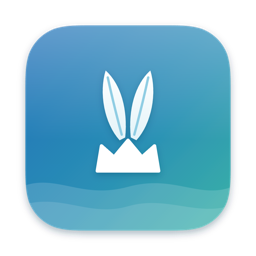
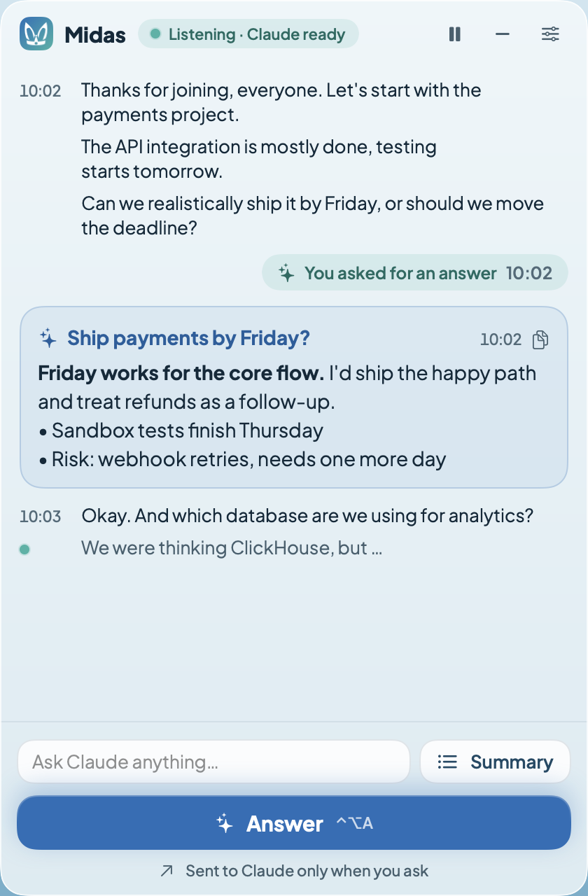

<p align="center">
  
</p>

<h1 align="center">Midas: open-source AI meeting copilot for Mac</h1>

<p align="center">
  <b>Live, on-device transcription of Zoom, Google Meet and Microsoft Teams calls, with answers from Claude or a local Ollama model in a panel that screen sharing can't see.</b><br>
  No bot joins the call. Audio never leaves your Mac.
</p>

<p align="center">
  <a href="https://onurkagan.github.io/midas-meeting-copilot/"><b>Website</b></a> ·
  <a href="#quick-start">Quick start</a> ·
  <a href="#how-it-works">How it works</a> ·
  <a href="#faq">FAQ</a>
</p>

<p align="center">
  <a href="LICENSE"></a>
  
  
  
  
  
</p>

<p align="center">
  
</p>

**Midas** is a free, open-source AI meeting assistant for macOS. It listens to whatever your Mac plays (Zoom, Google Meet, Microsoft Teams, Webex, Slack huddles…) and transcribes it in real time with Whisper, running locally on Apple Silicon. When someone asks you something, press **Answer**: Claude Code receives the conversation over MCP (the Model Context Protocol) and drafts a reply you can say out loud. Prefer to keep everything on your Mac? Pick a local model in [Ollama](https://ollama.com) instead. The reply appears in a small floating panel that stays out of screen shares, screenshots and recordings.

## Features

- **Works with any meeting app.** Midas captures system audio, so it works with Zoom, Google Meet, Microsoft Teams, Webex, Slack, FaceTime, or a video in your browser. Nothing to install in the meeting app.
- **No meeting bot.** Nobody sees "Notetaker joined". There's no virtual audio driver either: audio comes straight from macOS's Core Audio process tap API.
- **Private, on-device transcription.** Whisper large-v3-turbo runs locally with MLX. Audio never leaves your Mac; only text goes to Claude, and only when you ask.
- **Or fully local with Ollama.** Choose any model you've pulled into Ollama in the panel's settings. Answers stream in as the model writes them, and the meeting never leaves your Mac. No Claude account needed.
- **Hidden from screen sharing.** The panel and its menu bar icon are marked `NSWindow.sharingType = .none`. The panel has no Dock icon, doesn't appear in ⌘⇥ and never takes focus from the meeting app.
- **Answers on demand.** One press (or ⌃⌥A) and Claude replies to the latest question within seconds. **Summary** lists decisions and action items so far.
- **One timeline.** What was said, where you asked, and Claude's reply, in one scroll, with the sentence being spoken shown live.
- **Light on your Claude plan.** About 4k tokens of context per call and no calls until you press. A 30-minute meeting on Opus uses roughly 0.1% of a Max plan's 5-hour limit.
- **Your choice of model.** Claude Opus, Sonnet or Haiku at low to max effort, or any local Ollama model, from the panel.
- **Multilingual.** Turkish and English by default; any of Whisper's languages through `config.toml`.
- **Meeting notes in Markdown.** Each transcript and Claude's replies are saved to `sessions/YYYY-MM-DD_HH-MM.md`.
- **Answers from your codebase.** The MCP server also works inside your own repository, so Claude can answer technical questions from your code.

## How it works

```
System audio ──► midas-audio (Swift, Core Audio tap, 16 kHz PCM)
                   │
                   ▼
              Midas daemon (Python)
              VAD → Whisper (local) → event log ──► sessions/*.md
                   │  127.0.0.1:47821      └──► Ollama (local model, optional)
          ┌────────┴─────────┐
          ▼                  ▼
   midas-overlay        MCP bridge (stdio) ◄──► Claude Code (/midas loop)
   (hidden panel)       wait_for_conversation · show_answer · get_transcript
```

Claude Code runs the `/midas` command as a loop. `wait_for_conversation` blocks until you press **Answer** in the panel, then returns everything transcribed since the last answer, plus the sentence still being spoken. Claude drafts a reply to the latest question and posts it to the panel with `show_answer`. To let Claude also suggest replies on its own, set `auto_answer = true` in `config.toml`.

With **Ollama** chosen in the panel, Claude Code isn't involved: the daemon sends the transcript to the local model itself and streams the reply into the panel.

## Quick start

You need an Apple Silicon Mac with macOS 14.4 or later and a Claude account. Paste this into Terminal:

```bash
curl -fsSL https://raw.githubusercontent.com/onurkagan/midas-meeting-copilot/main/install.sh | bash
```

The [installer](install.sh) sets up what's missing (Xcode command line tools, Python, [Claude Code](https://docs.claude.com/claude-code)) and asks you to sign in to Claude Code. It then downloads Midas into `~/midas-meeting-copilot`, builds it, downloads the Whisper model (~1.6 GB) and opens Midas.app from `/Applications`. Run the same command again to update; your settings and meeting logs are kept.

**Manual setup:** with the Xcode command line tools and Claude Code installed. `./midas setup` uses Python 3.11 or later if you have it (Homebrew's too, even when it isn't on your `PATH`); otherwise it installs Python 3.12 with [uv](https://docs.astral.sh/uv/) into `~/.local`, nothing system-wide.

```bash
git clone https://github.com/onurkagan/midas-meeting-copilot.git
cd midas-meeting-copilot
./midas setup
./midas install
```

`./midas setup` builds the Swift components, creates the `.venv` environment, downloads the Whisper model (~1.6 GB) and writes `.mcp.json` for Claude Code. `./midas install` puts `Midas.app` in `/Applications`.

**Audio permission:** On first run, macOS asks for "System Audio Recording" permission for **midas-audio**; allow it. The permission doesn't depend on which terminal launches Midas, because midas-audio holds its own. If you denied it, the panel shows a warning. To enable it later: System Settings → Privacy & Security → Screen & System Audio Recording → **System Audio Recording Only** → midas-audio. Midas picks up the change within a few seconds. macOS may ask again after `./midas setup` rebuilds the components.

## Using the app

Open Midas from Spotlight (⌘Space → Midas): listening starts, the hidden panel appears and Claude Code runs in the background as the copilot. No terminal window opens; you talk to Claude through the panel. To quit, use **Quit Midas** in the panel's settings (⚙︎).

- macOS doesn't let apps run code from the Desktop or Documents folders, so the app runs a copy of this folder from `~/Library/Application Support/Midas`.
- `context.md`, `config.toml` and the meeting logs (`sessions/`) live there too. **Open folder** in the panel's settings (⚙︎) opens that folder.
- After changing code in this folder, run `./midas install` again; your settings and logs are kept.
- Click Midas's ears in the menu bar to show or hide the panel. Reopening Midas.app also brings a hidden panel back.
- The panel's settings (⚙︎) pick Claude's model (Opus, Sonnet, Haiku) and effort (Low, Medium, High, Max). The default is Opus · medium. The choice is saved, and Claude restarts with it within ~10 s.
- **Usage limits:** The app's Claude runs with only the Midas tools and a short system prompt (~4k tokens of context per call). It makes no calls until you press the button, and each **Answer** is a single call. By our measurements, a 30-minute meeting on Opus uses roughly 0.1% of a Max plan's 5-hour limit.

### Local models with Ollama

1. Install [Ollama](https://ollama.com/download) and pull a model, for example `ollama pull llama3.2`. Small models (around 3–4B parameters) answer fastest; larger ones such as `qwen3:8b` or `gemma3:12b` give better answers but take longer.
2. In the panel's settings (⚙︎), choose **Ollama · local**, then a model from the list.

- Answers appear in the timeline word by word as the model writes them. For models that can think before answering, thinking is turned off so replies come quickly.
- Ollama keeps the model loaded for 30 minutes between answers; after that, the next answer loads it again.
- `config.toml` sets `ollama_host` (default: `$OLLAMA_HOST` or `127.0.0.1:11434`), the default `ollama_model` and the context window `ollama_context`.
- Claude Code isn't needed in this mode. The installer still sets it up, but you can skip signing in.

### The panel

| Shortcut | Action |
| --- | --- |
| ⌃⌥M | Show/hide the panel (clicking the menu bar icon or reopening Midas also brings it back) |
| ⌃⌥A | **Answer**: have Claude reply to what has been said so far |
| ⌃⌥P | Pause/resume listening |

The whole meeting flows in one timeline: what was said, where you asked for an answer, and Claude's reply right below your request. The sentence being spoken appears live at the bottom. When someone asks a question, press **Answer** (or ⌃⌥A); the reply appears within a few seconds. The timeline follows along while you're at the bottom; if you scroll up to reread something, a **New** button takes you back. You can also type a specific request to Claude in the text field, and **Summary** lists the decisions and action items so far. The icon on each reply copies its text. The status pill at the top shows whether Midas is listening and Claude is ready; the ⚙︎ drawer holds the model and effort choice, the hotkeys, **Open folder** and **Quit Midas**.

### Personalizing

- `context.md`: who you are, your role, your projects, the meeting agenda. Claude reads it at the start of every session.
- `config.toml`: languages (`languages = ["tr", "en"]`), Whisper model, names and terms to spell correctly (`vocabulary`), silence threshold, automatic replies (`auto_answer`).
- `.claude/commands/midas.md`: Claude's behavior and reply style (when to answer, length, tone).

## Using it from a terminal

```bash
./midas start
```

The daemon starts in the background, the panel opens at the top right, and Claude Code enters the `/midas` copilot loop. On first launch Claude Code asks you to approve the `midas` server from `.mcp.json`. Quitting Claude Code also stops the daemon.

To give Claude a focus for this particular meeting, inside Claude Code:

```
/midas Pricing call with a customer today, my discount limit is 10%
```

For faster replies, pick a faster model: `./midas start --model sonnet`.

### Using it in your own repository

For technical meetings where Claude should answer from your codebase, add the MCP server at user scope:

```bash
claude mcp add --scope user midas -- "$PWD/midas" mcp   # run from the Midas folder
```

Then start the Midas daemon (`./midas run` or `./midas start`), open `claude` in your repository and run the `/mcp__midas__copilot` prompt.

### Commands

```
./midas setup            install / rebuild
./midas install          install (or update) Midas.app in /Applications
./midas start [args]     daemon + Claude Code (/midas)
./midas run [--input F]  run the daemon in the foreground; --input plays an audio file for testing
./midas stop             stop the daemon
./midas status           status
./midas logs             follow the logs
```

To try it without a meeting: `./midas run --input recording.m4a`, then `claude` → `/midas` in another terminal.

## How Midas compares

| | Midas | Meeting bots | Cloud note-takers |
| --- | --- | --- | --- |
| Joins the call as a participant | No | Yes | Varies |
| Where audio is transcribed | On your Mac | Vendor's cloud | Vendor's cloud |
| Live answers during the call | Yes, on demand | Some | Some |
| Panel hidden from screen sharing | Yes | — | — |
| Works fully offline | Yes, with Ollama | No | No |
| Open source, self-hosted | Yes (MIT) | Usually not | Usually not |

Looking for an open-source alternative to tools like Cluely or Granola? Midas gives live answers in an overlay that's hidden from screen sharing and keeps meeting notes without a bot, with transcription running locally and Claude as the model.

## FAQ

**Can other participants see Midas in Zoom, Google Meet or Microsoft Teams?**
Midas never joins the meeting: there's no bot, no extra participant and no virtual microphone or speaker. The panel asks macOS to keep it out of screen capture (`NSWindow.sharingType = .none`). Whether a capture tool respects that depends on how it records the screen, so do a test share before an important meeting; sharing a single window instead of the whole screen is the safest option.

**Does Midas record my meetings or upload audio?**
No. Audio is transcribed in memory on your Mac and isn't saved or uploaded. The text transcript is saved locally in `sessions/`, and text is sent to Claude only when you press **Answer** or **Summary** (or continuously if you turn on `auto_answer`). With a local Ollama model, no text leaves your Mac either.

**Can I use Midas without Claude, fully offline?**
Yes. Install [Ollama](https://ollama.com), pull a model, and choose **Ollama · local** in the panel's settings. Transcription and answers then both run on your Mac.

**Which languages does it understand?**
Turkish and English by default. Whisper supports about 100 languages; set them with `languages` in `config.toml`.

**Does it transcribe my own voice?**
No. Midas captures system audio only, so Claude hears the other participants. Speakers aren't told apart.

**What do I need to run it?**
An Apple Silicon Mac (M1 or later) with macOS 14.4 or later, and either Claude Code signed in to your Claude account or Ollama with a model you've pulled. It doesn't run on Intel Macs, Windows or Linux: it relies on MLX and on Core Audio process taps, added in macOS 14.4.

**How much of my Claude usage does it take?**
By our measurements, a 30-minute meeting on Opus uses about 0.1% of a Max plan's 5-hour limit, because Claude makes a single, small call each time you press **Answer**.

**Is it legal to transcribe a meeting?**
Rules on recording and transcribing conversations differ by country and state, and some require everyone's consent. Tell the other participants when your situation calls for it.

## Limitations

- Only system audio is captured, so your own voice isn't in the transcript; Claude hears only the other participants. Speakers aren't told apart.
- The panel's invisibility relies on macOS's window sharing flag. Check with a test share before an important meeting; sharing a single window instead of the whole screen is the safest option.
- Reply latency is ~1 s of transcription after someone stops talking, plus the Claude model's response time.

## Development

- **Panel design:** the live panel is hidden from screenshots, so check the design with sample data instead: `./bin/midas-overlay --render-preview <folder>` writes PNGs of a meeting, a drafting state with the settings open, and the empty state.
- **App icon:** `assets/icon/Midas.svg` is generated by `assets/icon/src/generate.py`; the fur is seeded strokes, so change the generator rather than the SVG. `assets/icon/src/build.sh` regenerates the SVG and renders `Midas-1024.png` with headless Chrome, which `./midas install` turns into the app icon.
- **Website:** the project site in `docs/` is served by GitHub Pages. `scripts/build_site.sh` re-renders its images (icon sizes, panel screenshots and the social preview card from `assets/social/card.html`).

## About the name

In the myth, Apollo gave King Midas the ears of a donkey, and his barber couldn't keep the secret. Midas's ears hear everything said in the meeting, and keep it to themselves.

## License

[MIT](LICENSE). Midas isn't affiliated with Anthropic, Zoom, Google or Microsoft.
